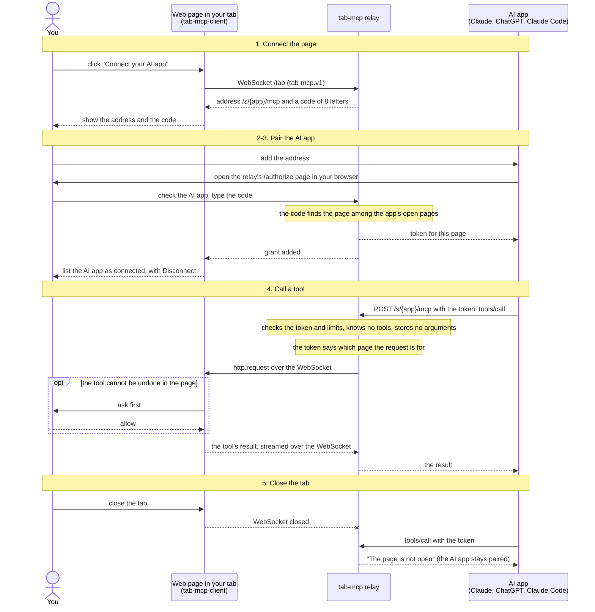

# tab-mcp

Connect your AI app to a web page open in a browser tab.

A web page offers some of its functions as [MCP](https://modelcontextprotocol.io) tools.
The page connects to a tab-mcp relay and shows its address, which is the same for every
page of that app. You add the address to your AI app (Claude, ChatGPT, Claude Code,
Codex; see [compatibility](docs/compatibility.md) for which apps work) and type a code
that the page shows: the code tells the relay which open page is yours. The AI app then
calls the page's tools through the relay while the tab stays open. Nothing has to be
installed on your computer.

The page does this with the tab-mcp client library. A page that offers its tools only
with the browser's WebMCP reaches an AI app through the tab-mcp browser extension:
[How the parts fit together](#how-the-parts-fit-together).

<!-- The GIF lives on ractive.ch (static/tab-mcp/demo/ in ractive.ch), not in this
     repository; the link leads to the video there. -->
[](https://ractive.ch/tab-mcp/#demo)

The demo: the [diagram editor](https://ractive.ch/tab-mcp/examples/diagram/) connected to
Claude Desktop, then Claude calling the page's tools (45 s; waiting cut, Claude's work sped up).

## How the parts fit together

<!-- The picture is docs/overview.svg, drawn by hand in the look of the diagrams on
     https://ractive.ch/tab-mcp/ (boxes, arrows, label tags; light and dark). A copy is
     static/images/tab-mcp-overview.svg in ractive.ch, shown there with a short version
     of this text; keep them in step. -->


tab-mcp has three parts:

- **The relay** ([`@ractive-ch/tab-mcp`](packages/tab-mcp/README.md)) is a server in
  the middle. An AI app adds it as a remote MCP server: an address, then a pairing
  code. Pages and the extension connect to it with a WebSocket. It passes requests on
  and knows no tools. A site runs its own relay; the hosted one, `tab-mcp.ractive.ch`,
  is for ractive.ch's examples and the extension's default.
- **The client library** ([`@ractive-ch/tab-mcp-client`](packages/tab-mcp-client/README.md))
  is for site owners. The site builds it into a page and registers tools with it. The
  page then connects to the relay itself.
- **tab-mcp browser extension** ([`packages/tab-mcp-extension`](packages/tab-mcp-extension/README.md))
  is a browser extension for users. It reads the
  [WebMCP](https://webmachinelearning.github.io/webmcp/) tools of the page in front and
  offers them to the AI app through the relay.

WebMCP is the browser's own way for a page to offer tools
(`document.modelContext.registerTool()`), a draft of the W3C Web Machine Learning
Community Group ([explainer](https://github.com/webmachinelearning/webmcp)). Its tools
reach only agents inside the browser, and only where the browser has WebMCP turned on.
Chrome has it for sites in its
[origin trial](https://developer.chrome.com/blog/ai-webmcp-origin-trial) and behind a
flag (`chrome://flags/#enable-webmcp-testing`), Edge for sites in its own origin trial;
Firefox and Safari do not have it. Where the browser has none, the tab-mcp browser
extension gives pages a WebMCP of its own (below).

A page's tools reach an AI app outside the browser on one of two paths. Which one
depends on how the page offers its tools:

| | Page with the client library | Page with WebMCP tools only |
|---|---|---|
| The site | builds in `@ractive-ch/tab-mcp-client` and has a relay that allows its origin | calls `document.modelContext.registerTool()` where the page finds it; needs nothing of tab-mcp |
| The user needs | any browser (Chrome, Edge, Firefox, Safari), and installs nothing | the tab-mcp browser extension, from the [Chrome Web Store](https://chromewebstore.google.com/detail/tab-mcp-browser-extension/jjhddplkjikmbpcobcnfebnglgjomfgh) in Chrome; with Chrome's WebMCP off (no flag, the site not in the origin trial), its access to all sites too ([the extension](#the-tab-mcp-browser-extension)) |
| The user connects | in the page: "Connect your AI app" shows the address and the code | in the extension's side panel, once: one address for whatever page is in front |
| The user is asked | by the page, before a tool the site marked as consequential | by the extension, before a tool the page did not mark read-only, and before its navigation tools take the tab to another site |

**If you run a site**, the client library reaches the most users: it works in every
current browser and your users install nothing. You run a relay for it
([Self-hosting](#self-hosting)). With WebMCP tools only, you run nothing, but your tools
reach AI apps outside the browser only for users who installed the tab-mcp browser
extension. You can do both: `new TabMcp({ ..., webmcp: true })` also registers
the library's tools with WebMCP. The
[diagram editor](https://ractive.ch/tab-mcp/examples/diagram/) does, so it works on
both paths.

**If you use a site**, look for "Connect your AI app" in the page: that page has the
client library and you need nothing else. On a page without it, the tab-mcp browser extension
offers your AI app the page's WebMCP tools, if the page has any. It reads a tab only
after you click its icon there, or after you give it access to all sites. The extension
also has tools of its own, which work on pages without tools too: `page_info` says
which page is in front, and `navigate`, `go_back`, `go_forward` and `reload` move the
tab.

The extension reads only WebMCP tools. A page that offers its tools with the client
library alone, without `webmcp: true`, has none for it.

### The tab-mcp browser extension

- **What the browser must have:** Chrome 116 or later, or Firefox 140 or later for the
  Firefox build. It needs no WebMCP of its own.
- **What the extension adds:** it passes the page's WebMCP tools on to the AI app. Where
  the browser has WebMCP on (Chrome with the flag, or a site in Chrome's origin trial),
  those are the tools the page registered with the browser. Where it has none (Firefox,
  Chrome without either), the extension gives each https page (and localhost) its own
  `document.modelContext` as the page starts loading, so that a page that registers its
  tools wherever the API exists registers them with the extension. That needs "Give
  access to all sites": a click on the icon comes after the page has looked for the API.
- **Where it can be installed today:** the Chrome build from the
  [Chrome Web Store](https://chromewebstore.google.com/detail/tab-mcp-browser-extension/jjhddplkjikmbpcobcnfebnglgjomfgh).
  Every release is also submitted to Microsoft Edge Add-ons (DEC-194), but that listing
  is not public yet (checked on 2026-11-22).
  The Firefox build is not on addons.mozilla.org yet (its release is
  [pull request 163](https://github.com/ractive/tab-mcp/pull/163)); it can be built from
  this repository and loaded as a temporary add-on
  ([In Firefox](packages/tab-mcp-extension/README.md#in-firefox)). There is none for
  Safari; pages reach Safari users with the client library.

## Live examples

Try it without installing anything. These pages connect to the hosted relay
`tab-mcp.ractive.ch` (overview: <https://ractive.ch/tab-mcp/>):

| Page | What your AI app can do there |
|---|---|
| [Diagram editor](https://ractive.ch/tab-mcp/examples/diagram/) | draw, read and rearrange a diagram of boxes and arrows with you, and get it as a picture |
| [Todo (React)](https://ractive.ch/tab-mcp/examples/todo/) | list, add, complete and delete todos in a React single-page app (an AI app's delete asks you in the page first); based on [examples/react-todo](examples/react-todo) |
| [saturnus](https://ractive.ch/saturnus/) | use an HP 48 calculator emulator |
| [Sign-in example](https://tab-mcp-login.ractive.ch/) | read, add and delete notes; the AI app connects by signing in with the same Google account as the page, without a code ([identity binding](#identity-binding)) |

The hosted relay is run for ractive.ch's examples, not as a service for other pages.
It refuses every origin it does not list, and the page then shows "Could not connect
to the relay (refused, unreachable, or this page's origin is not allowed)." For your
own page, run your own relay, as in
[Quick start for page authors](#quick-start-for-page-authors) for development and
[Self-hosting](#self-hosting) for production.

## How it works

<!-- Mermaid source (https://mermaid.js.org): GitHub draws it. Edit the text; try changes
     at https://mermaid.live. Keep it in step with the numbered steps below and with the
     copy on https://ractive.ch/tab-mcp/ (src/tab-mcp/how-it-works.mmd in ractive.ch). -->


1. You click "Connect your AI app" in the page. The page opens a WebSocket to the relay
   and shows an address and a code of 8 letters. The address names the app
   (`https://<relay>/s/<app>/mcp`) and is the same for everyone who has a page of that
   app open; the code belongs to your page.
2. You add the address to your AI app. The AI app opens the relay's sign-in page in your
   browser. It names the AI app and the app of the address; you type the code. The
   relay finds your page by the code.
3. The AI app gets a token for your page. The page lists it as connected, with a
   Disconnect button.
4. When the AI app calls a tool, the relay finds the page by the token and forwards the
   request to it. The page runs the tool and answers. Tools whose effect you cannot undo
   in the page (deleting for good, sending, buying) ask you in the page first.
5. When you close the tab, the tools are gone. The AI app stays paired and can use the
   tools again the next time you connect the page.

The relay sees tool arguments and results but does not log or store them. It stores
only hashes of tokens. More in the [threat model](docs/threat-model.md).

## When to use something else

tab-mcp is for state that lives only in the browser (a drawing, an emulator, a form being
filled in), and for acting as the signed-in user in their open tab. If a page's state
lives on its server, an MCP server on that backend is the better answer: it works while
no tab is open, needs no relay in between, and can check who calls with the site's own
accounts. If the agent runs in the browser itself, it calls the tools a page registers
with WebMCP without a relay.

## Quick start for users

You need a page that offers tab-mcp, such as the [live diagram editor](https://ractive.ch/tab-mcp/examples/diagram/).

1. In the page, click "Connect your AI app" and copy the address.
2. Add it to your AI app:
   - **Claude Code:** `claude mcp add --transport http diagram <address>`, then run `/mcp`
     in Claude Code and choose Authenticate.
   - **Claude (claude.ai and the desktop app):** Settings → Connectors → Add custom
     connector, then paste the address.
   - **ChatGPT:** on chatgpt.com, open [Plugins](https://chatgpt.com/plugins) and add an
     MCP server with the address.

   Step by step for each app, and what to do when it fails:
   [connecting an AI app](https://ractive.ch/tab-mcp/connect/).
3. Your browser opens the relay's page "Connect … from …". Check the AI app it names,
   then type the code that “Connect your AI app” shows on the page.
4. Ask your AI app to use the page. To stop, click Disconnect in the page, or close the
   tab.

claude.ai, Claude Desktop and ChatGPT on the web connect from their own servers, so they
need a relay with a public HTTPS address. All three work; see
[compatibility](docs/compatibility.md).

**Connecting an AI app to a page means trusting that page.** The page decides what its
tools do and how they are described. Connect only pages you trust, and type a code only
for an AI app you started yourself. See [SECURITY.md](SECURITY.md).

## Quick start for page authors

1. Run a relay that allows your page's origin. For local development with Docker:

   ```sh
   docker run --rm -p 8080:8080 \
     -e NODE_ENV=development \
     -e TAB_MCP_PUBLIC_URL=http://localhost:8080 \
     -e TAB_MCP_ALLOWED_ORIGINS=http://localhost:3000 \
     -e TAB_MCP_STORE=memory \
     ractive/tab-mcp:0.13.3-rc.1
   ```

2. Install the browser library:

   ```sh
   npm install @ractive-ch/tab-mcp-client
   ```

3. Register tools and add a button:

   ```ts
   import { TabMcp } from "@ractive-ch/tab-mcp-client";

   const mcp = new TabMcp({
     relay: "http://localhost:8080",
     server: { name: "notes", version: "1.0.0" },
     appName: "notes",
   });

   await mcp.registerTool<{ text: string }>({
     name: "add_note",
     title: "Add a note",
     description: "Add a note (at most 500 characters) to the list on the page and return its id.",
     inputSchema: {
       type: "object",
       properties: { text: { type: "string", minLength: 1, maxLength: 500 } },
       required: ["text"],
       additionalProperties: false,
     },
     execute: ({ text }) => addNote(text),
   });

   connectButton.addEventListener("click", () => mcp.showConnectDialog());
   ```

4. Open your page on `http://localhost:3000`, click the button and connect an AI app.

A Chrome or Edge extension can offer tools the same way, from its service worker or one
of its own pages (such as its side panel); the relay's heartbeat keeps a service worker
alive while it is connected (Chrome 116+, with the heartbeat under 30 s). In a service
worker, pass `storage` and `onConfirm`: it has no `localStorage` and no document (see
[browser extensions](docs/configuration.md#browser-extensions)). The relay then lists
`chrome-extension://<id>`.

Mark tools whose effect the user cannot undo in the page, or that act outside it (delete
for good, send, buy, change data on the server), with
`annotations: { consequentialHint: true }`: the page then asks the user before each call
of an AI app ("Always allow" only if the page turns on `alwaysAllow`). A change the user sees and can
take back in the page, such as `add_note` above, needs no question.

A site with its own AI assistant on the page can serve the tools to it over a
`MessagePort` with `mcp.serve(port, { client })`, without a relay, pairing or an address;
calls then come with `client.kind === "local"`, and `serve`'s `onConfirm` asks for them in
the site's own chat. See
[Your own assistant on the page](packages/tab-mcp-client/README.md#your-own-assistant-on-the-page).

`new TabMcp({ ..., webmcp: true })` also registers the tools with the browser's WebMCP
where the browser has it, so that agents in the browser call them without pairing, with
the same argument check, tools that ask included. The library shows no question for a
WebMCP call that the tab-mcp browser extension did not vouch for: an agent that drives
the tab answered it itself. Such a call can also come from another extension for an AI
app outside the browser, or from a document of an origin named in `exposedTo`, which
cannot click in the page; the page cannot tell them apart. A tool that asks is marked
`consequentialHint`, so that a caller that heeds it asks its user; beyond that only the
page's `onConfirm`, in code, or `callers` without `"webmcp"` stops such a call. `callers` in a tool's registration says which
callers see it. See [who asks](packages/tab-mcp-client/README.md#who-asks-before-a-tool-that-asks-runs)
in the client README.

The [client README](packages/tab-mcp-client/README.md) covers the whole API; the
[live examples](https://ractive.ch/tab-mcp/) show what pages can offer.

There is no public relay for other sites: run your own ([Self-hosting](#self-hosting)).

### Agent skill

With a coding agent, you only need the install. The browser library comes with an
[Agent Skill](plugins/tab-mcp/skills/tab-mcp/SKILL.md) that teaches the agent to add
tab-mcp to a web app, written for the version you installed:

```sh
npm install @ractive-ch/tab-mcp-client
```

Then tell your agent:

```text
Read node_modules/@ractive-ch/tab-mcp-client/skill/SKILL.md and add tab-mcp to this app.
```

and ask for what you want: which features of the page AI apps may use, and which of them
ask first. No such file means the installed version is older than this guide: update the
package. The path is relative to the folder of the app that installed the package (in a
monorepo, that app's folder), with npm, Bun, pnpm and Yarn's `node_modules` linker alike;
see the [client README](packages/tab-mcp-client/README.md#with-a-coding-agent) for Yarn
Plug'n'Play.

The same skill is also a plugin. It comes from this repository's `main` branch, which
can be ahead of the last release. In Claude Code:

```text
/plugin marketplace add ractive/tab-mcp
/plugin install tab-mcp@tab-mcp
```

For Codex and claude.ai, see the [plugin README](plugins/tab-mcp/README.md).

### Identity binding

For pages where users sign in, a relay can pair by identity instead of a code: an AI app
connects only if the person signing in to the connection is the person signed in to the
page, at the same OpenID Connect provider (Google, Keycloak, Auth0, Okta, Entra ID, your
own). Your backend signs a short assertion for the page's user, and logging out of the
page ends the AI connection at once. Set `TAB_MCP_IDENTITY=oidc`; the
[configuration](docs/configuration.md#identity-binding) and the
[client README](packages/tab-mcp-client/README.md#identity-binding-no-code) show how.

## Self-hosting

The relay is one process with a SQLite file. Run it with Docker:

```sh
docker run -d --name tab-mcp -p 127.0.0.1:8080:8080 -v tab-mcp-data:/data \
  -e TAB_MCP_PUBLIC_URL=https://relay.example.com \
  -e TAB_MCP_ALLOWED_ORIGINS=https://app.example.com \
  ractive/tab-mcp:0.13.3-rc.1
```

Put it behind a reverse proxy or CDN with TLS, and run exactly one instance.
[Self-hosting](docs/self-hosting.md) explains the data volume, WebSockets, event streams
and proxy time limits, health checks, backups and upgrades, with a
[privacy notice template](docs/privacy-template.md) for your users;
[configuration](docs/configuration.md)
lists every setting and why the defaults are safe. The relay also runs without Docker on
Bun (`bun add --global @ractive-ch/tab-mcp`, then `tab-mcp`).

**Your own store.** The relay keeps grants and token hashes (never tokens) in SQLite by
default, or in memory. Embed it in your own Bun program with `createRelay()` and it takes
any object that implements the `TokenStore` interface: PostgreSQL, Redis, Prisma or
whatever your stack already runs. The package ships a conformance suite to check your
store; [token store](docs/token-store.md) has the interface, the guarantees a store must
give and an example. A shared store does not let several relay instances serve one
relay URL: tab sessions and the pairing codes the pages show live in the relay's memory,
so a relay is exactly one process.

## Packages

| Path | Published as | What |
|---|---|---|
| `packages/tab-mcp` | npm `@ractive-ch/tab-mcp`, Docker `ractive/tab-mcp` and `ghcr.io/ractive/tab-mcp` | the relay ([README](packages/tab-mcp/README.md)) |
| `packages/tab-mcp-client` | npm `@ractive-ch/tab-mcp-client` | the browser library a page uses ([README](packages/tab-mcp-client/README.md)) |
| `packages/tab-mcp-extension` | [Chrome Web Store](https://chromewebstore.google.com/detail/tab-mcp-browser-extension/jjhddplkjikmbpcobcnfebnglgjomfgh): "tab-mcp browser extension" 0.3.2 | the browser extension that offers the WebMCP tools of the page in front to an AI app ([README](packages/tab-mcp-extension/README.md)) |
| `examples/react-todo` | – | a React todo app with the React bindings, live at <https://ractive.ch/tab-mcp/examples/todo/> ([README](examples/react-todo/README.md)) |
| `test/e2e` | – | the end-to-end test: a relay, a test page in headless Chrome and an AI app's OAuth client ([README](test/e2e/README.md)) |
| `plugins/tab-mcp` | – | the agent skill and its plugin manifests ([README](plugins/tab-mcp/README.md)) |

## Documentation

- [Compatibility](docs/compatibility.md): which AI apps work, as tested
- [Configuration](docs/configuration.md): every `TAB_MCP_*` setting
- [Self-hosting](docs/self-hosting.md): deploying the relay with Docker, behind a reverse
  proxy or CDN; health checks, resource limits, backups, upgrades
- [Privacy notice template](docs/privacy-template.md): what an operator tells its users
- [Token store](docs/token-store.md): the `TokenStore` interface and its conformance suite
- [Protocol](docs/protocol.md): the WebSocket protocol `tab-mcp.v1` between page and relay
- [Threat model](docs/threat-model.md) and [security policy](SECURITY.md)
- Changelogs: [browser library](packages/tab-mcp-client/CHANGELOG.md), [relay](packages/tab-mcp/CHANGELOG.md), [the tab-mcp browser extension](packages/tab-mcp-extension/CHANGELOG.md)

## Status

**0.22.0-rc.1**. Until 1.0, a new minor version can still change
settings, the protocol or the API; the [changelogs](CHANGELOG.md) say what changed.

- Released: relay `@ractive-ch/tab-mcp` 0.13.3-rc.1 (npm and Docker) and browser library
  `@ractive-ch/tab-mcp-client` 0.22.0-rc.1, on the npm tag `latest`.
- The tab-mcp browser extension 0.3.2 is in the [Chrome Web Store](https://chromewebstore.google.com/detail/tab-mcp-browser-extension/jjhddplkjikmbpcobcnfebnglgjomfgh) (public since
  2026-11-16). A development build loaded unpacked has the store's id, which the hosted
  relay allows ([README](packages/tab-mcp-extension/README.md)).
- tab-mcp speaks only MCP revision 2026-07-28 and accepts only AI apps that register
  through OAuth Client ID Metadata Documents. Claude Code, claude.ai, Claude Desktop,
  ChatGPT (web and Mac) and Codex work (Codex and ChatGPT for Mac with the
  `mcp_2026_07_28` feature turned on); VS Code, Cursor and Gemini CLI
  cannot connect yet. Details in [compatibility](docs/compatibility.md).

## Development

Requires [Bun](https://bun.sh) 1.4.4 or newer.

```sh
bun install
# Once, for the browser tests: the pinned test browsers, never your own Chrome or Firefox
# (CI uses the same versions: Chrome for Testing through setup-chrome, this Firefox install)
bunx @puppeteer/browsers@3.2.7 install chrome@156.0.8078.80 --path ~/.cache/puppeteer
bunx @puppeteer/browsers@3.2.7 install firefox@stable_160.0.1 --path ~/.cache/puppeteer
bun run verify     # Biome, type check, tests, MCP conformance suite; no browser
bun run test:browser [filter]  # the browser tests (*.browser.test.ts), Chrome and Firefox;
                               # one run per machine, a second waits (--no-wait: fails);
                               # --no-firefox / --no-chrome leave files out, --system-firefox
                               # takes the installed Firefox; no notification on the desktop
bun run test:browser --no-full  # what a pull request runs: all but the *-full.browser.test.ts
                                # files (the rest of Firefox), which
                                # browser-full.yml runs nightly and on changes to main
bun run test:browser --sweep --dry-run  # what a run would clean up from killed runs
                                        # (in ~/.cache/tab-mcp/browser-tests only; takes the lock)
bun run verify:all # both
bun run conformance  # only the official MCP conformance suite (relay and library)
bun run fix        # format and apply safe lint fixes
```

## Licence

MIT, see [LICENSE](LICENSE) and [AI_NOTICE](AI_NOTICE).
