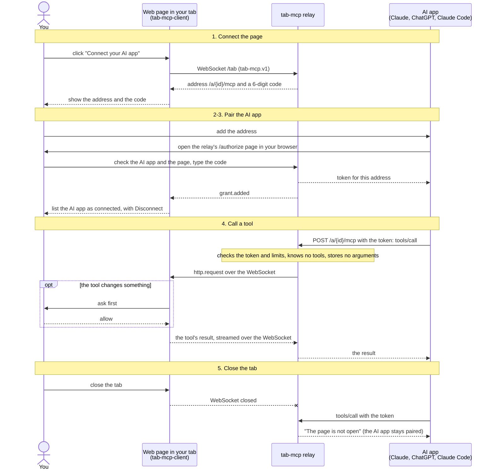

# tab-mcp

Connect your AI app to a web page open in a browser tab.

A web page offers some of its functions as [MCP](https://modelcontextprotocol.io) tools.
The page connects to a tab-mcp relay and gets an address. You add the address to your AI
app (Claude, ChatGPT, Claude Code; see [compatibility](docs/compatibility.md) for which
apps work) and type a code that the page shows. The AI app then calls the page's tools
through the relay while the tab stays open. Nothing has to be installed on your
computer.

<!-- The GIF lives on ractive.ch (static/tab-mcp/demo/ in ractive.ch), not in this
     repository; the link leads to the video there. -->
[](https://ractive.ch/tab-mcp/#demo)

The demo: the [diagram editor](https://ractive.ch/tab-mcp/examples/diagram/) connected to
Claude Desktop, then Claude calling the page's tools (45 s; waiting cut, Claude's work sped up).

## Live examples

Try it without installing anything. These pages connect to the hosted relay
`tab-mcp.ractive.ch` (all of them: <https://ractive.ch/tab-mcp/>):

| Page | What your AI app can do there |
|---|---|
| [Diagram editor](https://ractive.ch/tab-mcp/examples/diagram/) | draw, read and rearrange a diagram of boxes and arrows with you, and get it as a picture |
| [Todo (React)](https://ractive.ch/tab-mcp/examples/todo/) | list, add, complete and delete todos in a React single-page app (deleting asks you in the page first); its source is [examples/react-todo](examples/react-todo) |
| [saturnus](https://ractive.ch/saturnus/) | use an HP 48 calculator emulator |

The hosted relay runs these examples and is not open to other pages: it refuses
their origins ("this page's origin is not allowed"). For your own page, run your own
relay, as in [Quick start for page authors](#quick-start-for-page-authors) for
development and [Self-hosting](#self-hosting) for production.

## How it works

<!-- Mermaid source (https://mermaid.js.org): GitHub draws it. Edit the text; try changes
     at https://mermaid.live. Keep it in step with the numbered steps below and with the
     copy on https://ractive.ch/tab-mcp/ (src/tab-mcp/how-it-works.mmd in ractive.ch). -->


1. You click "Connect your AI app" in the page. The page opens a WebSocket to the relay
   and shows an address and a 6-digit code.
2. You add the address to your AI app. The AI app opens the relay's sign-in page in your
   browser. It names the AI app and the page; you type the code.
3. The AI app gets a token for that address. The page lists it as connected, with a
   Disconnect button.
4. When the AI app calls a tool, the relay forwards the request to the page. The page
   runs the tool and answers. Tools that change something ask you in the page first.
5. When you close the tab, the tools are gone. The AI app stays paired and can use the
   tools again the next time you connect the page.

The relay sees tool arguments and results but does not log or store them. It stores
only hashes of tokens. More in the [threat model](docs/threat-model.md).

## When to use something else

tab-mcp is for state that lives only in the browser (a drawing, an emulator, a form being
filled in), and for acting as the signed-in user in their open tab. If a page's state
lives on its server, an MCP server on that backend is the better answer: it works while
no tab is open, needs no relay in between, and can check who calls with the site's own
accounts.

## Quick start for users

You need a page that offers tab-mcp, such as the [live diagram editor](https://ractive.ch/tab-mcp/examples/diagram/).

1. In the page, click "Connect your AI app" and copy the address.
2. Add it to your AI app:
   - **Claude Code:** `claude mcp add --transport http calc <address>`, then run `/mcp`
     in Claude Code and choose Authenticate.
   - **Claude (claude.ai and the desktop app):** Settings → Connectors → Add custom
     connector, then paste the address.
   - **ChatGPT:** on chatgpt.com, open [Plugins](https://chatgpt.com/plugins) and add an
     MCP server with the address.

   Step by step for each app, and what to do when it fails:
   [connecting an AI app](https://ractive.ch/tab-mcp/connect/).
3. Your browser opens the relay's page "Connect … from …". Check the AI app and the
   page's address, then type the code shown in the page.
4. Ask your AI app to use the page. To stop, click Disconnect in the page, or close the
   tab.

claude.ai, Claude Desktop and ChatGPT connect from their own servers, so they need a
relay with a public HTTPS address. All three work; see
[compatibility](docs/compatibility.md).

**Connecting an AI app to a page means trusting that page.** The page decides what its
tools do and how they are described. Connect only pages you trust, and type a code only
for an AI app you started yourself. See [SECURITY.md](SECURITY.md).

## Quick start for page authors

1. Run a relay that allows your page's origin. For local development with Docker:

   ```sh
   docker run --rm -p 8080:8080 \
     -e NODE_ENV=development \
     -e TAB_MCP_PUBLIC_URL=http://localhost:8080 \
     -e TAB_MCP_ALLOWED_ORIGINS=http://localhost:3000 \
     -e TAB_MCP_STORE=memory \
     ractive/tab-mcp:0.6.1
   ```

2. Install the browser library:

   ```sh
   npm install @ractive-ch/tab-mcp-client
   ```

3. Register tools and add a button:

   ```ts
   import { TabMcp } from "@ractive-ch/tab-mcp-client";

   const mcp = new TabMcp({
     relay: "http://localhost:8080",
     server: { name: "notes", version: "1.0.0" },
     appName: "notes",
   });

   await mcp.registerTool({
     name: "add_note",
     description: "Add a note to the list on the page",
     inputSchema: {
       type: "object",
       properties: { text: { type: "string" } },
       required: ["text"],
     },
     execute: ({ text }) => addNote(String(text)),
   });

   connectButton.addEventListener("click", () => mcp.showConnectDialog());
   ```

4. Open your page on `http://localhost:3000`, click the button and connect an AI app.

Mark tools that change or delete things with `annotations: { consequentialHint: true }`:
the page then asks the user before each call. The
[client README](packages/tab-mcp-client/README.md) covers the whole API; the
[live examples](https://ractive.ch/tab-mcp/) show what pages can offer.

There is no public relay for other sites: run your own (next section).

### Agent skill

The repository has an [Agent Skill](plugins/tab-mcp/skills/tab-mcp/SKILL.md) that
teaches a coding agent to add tab-mcp to a web app. In Claude Code:

```text
/plugin marketplace add ractive/tab-mcp
/plugin install tab-mcp@tab-mcp
```

For Codex and claude.ai, see the [plugin README](plugins/tab-mcp/README.md).

### Identity binding

For pages where users sign in, a relay can pair by identity instead of a code: an AI app
connects only if the person signing in to the connection is the person signed in to the
page, at the same OpenID Connect provider (Google, Keycloak, Auth0, Okta, Entra ID, your
own). Your backend signs a short assertion for the page's user, and logging out of the
page ends the AI connection at once. Set `TAB_MCP_IDENTITY=oidc`; the
[configuration](docs/configuration.md#identity-binding) and the
[client README](packages/tab-mcp-client/README.md#identity-binding-no-code) show how.

## Self-hosting

The relay is one process with a SQLite file. Run it with Docker:

```sh
docker run -d --name tab-mcp -p 127.0.0.1:8080:8080 -v tab-mcp-data:/data \
  -e TAB_MCP_PUBLIC_URL=https://relay.example.com \
  -e TAB_MCP_ALLOWED_ORIGINS=https://app.example.com \
  ractive/tab-mcp:0.6.1
```

Put it behind a reverse proxy or CDN with TLS, and run exactly one instance.
[Self-hosting](docs/self-hosting.md) explains the data volume, WebSockets, event streams
and proxy time limits, health checks, backups and upgrades, with a
[privacy notice template](docs/privacy-template.md) for your users;
[configuration](docs/configuration.md)
lists every setting and why the defaults are safe. The relay also runs without Docker on
Bun (`bun add --global @ractive-ch/tab-mcp`, then `tab-mcp`).

**Your own store.** The relay keeps grants and token hashes (never tokens) in SQLite by
default, or in memory. Embed it in your own Bun program with `createRelay()` and it takes
any object that implements the `TokenStore` interface: PostgreSQL, Redis, Prisma or
whatever your stack already runs. The package ships a conformance suite to check your
store; [token store](docs/token-store.md) has the interface, the guarantees a store must
give and an example. A shared store does not let several relays serve one address: tab
sessions live in the relay's memory, so each address still needs exactly one process.

## Packages

| Path | Published as | What |
|---|---|---|
| `packages/tab-mcp` | npm `@ractive-ch/tab-mcp`, Docker `ractive/tab-mcp` and `ghcr.io/ractive/tab-mcp` | the relay ([README](packages/tab-mcp/README.md)) |
| `packages/tab-mcp-client` | npm `@ractive-ch/tab-mcp-client` | the browser library a page uses ([README](packages/tab-mcp-client/README.md)) |
| `examples/react-todo` | – | a React todo app with the React bindings, live at <https://ractive.ch/tab-mcp/examples/todo/> ([README](examples/react-todo/README.md)) |
| `test/e2e` | – | the end-to-end test: a relay, a test page in headless Chrome and an AI app's OAuth client ([README](test/e2e/README.md)) |
| `plugins/tab-mcp` | – | the agent skill and its plugin manifests ([README](plugins/tab-mcp/README.md)) |

## Documentation

- [Compatibility](docs/compatibility.md): which AI apps work, as tested
- [Configuration](docs/configuration.md): every `TAB_MCP_*` setting
- [Self-hosting](docs/self-hosting.md): deploying the relay with Docker, behind a reverse
  proxy or CDN; health checks, resource limits, backups, upgrades
- [Privacy notice template](docs/privacy-template.md): what an operator tells its users
- [Token store](docs/token-store.md): the `TokenStore` interface and its conformance suite
- [Protocol](docs/protocol.md): the WebSocket protocol `tab-mcp.v1` between page and relay
- [Threat model](docs/threat-model.md) and [security policy](SECURITY.md)
- [Changelog](CHANGELOG.md)

## Status

**0.10.0**. Until 1.0, a new minor version can still change
settings, the protocol or the API; the [changelog](CHANGELOG.md) says what changed.

- Released: relay `@ractive-ch/tab-mcp` 0.6.1 (npm and Docker) and browser library
  `@ractive-ch/tab-mcp-client` 0.10.0, on the npm tag `latest`.
- tab-mcp speaks only MCP revision 2026-07-28 and accepts only AI apps that register
  through OAuth Client ID Metadata Documents. Claude Code, claude.ai, Claude Desktop,
  ChatGPT (web and Mac) and Codex work (Codex and ChatGPT for Mac with the
  `mcp_2026_07_28` feature turned on); VS Code, Cursor and Gemini CLI
  cannot connect yet. Details in [compatibility](docs/compatibility.md).

## Development

Requires [Bun](https://bun.sh) 1.4.

```sh
bun install
bun run verify     # Biome, type check, tests, MCP conformance suite
bun run conformance  # only the official MCP conformance suite (relay and library)
bun run fix        # format and apply safe lint fixes
```

## Licence

MIT, see [LICENSE](LICENSE) and [AI_NOTICE](AI_NOTICE).
