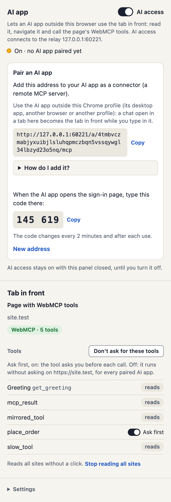
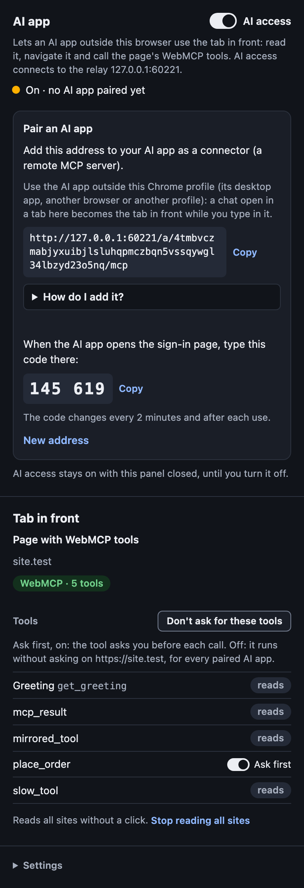
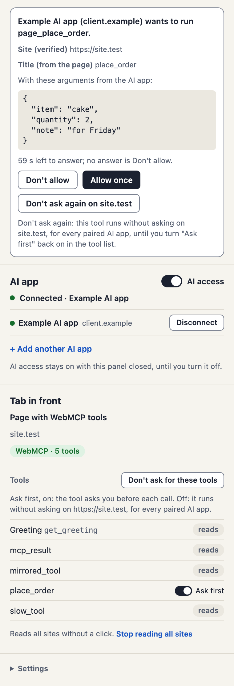
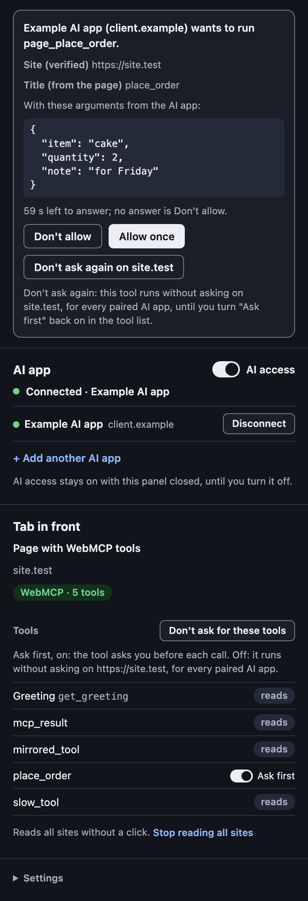

# tab-mcp for Chrome: the look

## Why

The owner, 2026-11-13: "Overmark did a redesign of the Chrome extension. Apply the same
design language and best practices to tab-mcp-extension as well." Overmark's side panel
holds a copy of this extension's AI app card (its iteration 10), so a user with both
extensions sees the same card twice; after Overmark's redesign the two no longer look
alike.

Source: Overmark PR 51 ("The look: paper and ink, colour is a mark's status, amber
once", merge `3779e8e`) with its review commits, its `kb/design/ux-review-2026-11.md`
(section "Visual direction") and its DEC-024. Read there: `src/sidepanel/style.css`,
`test/contrast.test.ts`, `test/e2e/look.test.ts`.

The note was written before iteration H of the review landed (iteration 36: the panel's
wording and accessibility, EQ 2, 6, 7, 8, 9, 11, 13, 16, 17), against the panel as it
was then, and built on top of it in
[iteration 39](../iterations/iteration-39-extension-look.md) (DEC-160 to DEC-163).
"Today's panel" below is the panel before both; [As built](#as-built) says where the
build differs from the plan, with screenshots.

## What Overmark's look is

1. **Paper and ink.** The panel is paper (`--paper`) with sheets (`--sheet`) on it.
   Structure comes from space, rules (`--rule`, decoration only) and edges (`--edge`)
   that reach 3:1 against what they stand on. No band, no shadows.
2. **Every colour is a token, every pair is computed.** One `:root` block and one dark
   block under `prefers-color-scheme: dark`. A table lists each pair that is used with
   its WCAG 2.2 ratio in both schemes: text 4.5:1, boundaries and large text 3:1. A
   unit test reads the two blocks from `style.css` and asserts the table.
3. **Amber once.** Amber marks the one action of a view that starts drawing. Every
   other main action is the ink "strong" button.
4. **Colour is a status**, never decoration, and never the only carrier: a status has
   a word or a glyph beside its colour.
5. **One type scale, system fonts only**: 13/19 body, 15/20/700 section headings,
   12/16/600 group headings in `--ink-2`, 12/17 meta, 12/17 mono for addresses and
   code. No uppercase micro-labels.
6. **One spacing scale** (4, 8, 12, 16, 24, 32), a 16 px gutter, radii 6 (controls),
   10 (sheets, notices), 999 (pills, dots).
7. **Controls have a shape**: a default button is a sheet with a 1 px `--edge`, 30 px
   high (26 small); disabled is flat colours, never opacity alone; a quiet button is
   its words in `--link`; one `:focus-visible` rule for every control (2 px `--focus`,
   2 px offset).
8. **Messages**: a notice (warning fill, warning edge, text in `--ink`, one button)
   where something stands in the way and there is a way out; red (danger fill and
   edge) where something failed. The text is always `--ink`; the colour is in the
   fill, the edge and a sign.
9. **Motion**: two short transitions (0.12 s on a button's fill and border, 0.15 s on
   the switch), all off under `prefers-reduced-motion: reduce`.
10. **Forced colours**: every edge stays an edge (filled buttons get a `ButtonText`
    border), fills that carry meaning are set in system colours, and a forced-colours
    rule names the hover and focus selectors too, since those are more specific
    outside the block (Overmark commit `64bbad4`).
11. **Tooltips**: a button that can be an icon alone has a `title`; a status that
    matters is never tooltip-only (Overmark commits `25557dd`, `01b830d`).
12. **Tests guard it**: the contrast unit test, and an e2e test in a real browser: no
    sideways scroll at 345, 360 and 420 px in every view, at most one amber button per
    view, the tokens as computed under an emulated light and dark scheme.

## Today's panel, measured

`packages/tab-mcp-extension/src/sidepanel/style.css` (630 lines, also the question
window's style sheet). Ratios computed as Overmark's are (sRGB relative luminance).

| Pair today | Light | Dark | Needs |
|---|---|---|---|
| Button, field and card border (`--line`) on `--card` | 1.24 | 1.28 | 3 |
| `--card` on `--bg` | 1.08 | 1.12 | none (decoration) |
| Switch track off, grey dot (`--off`) on `--card` | 2.54 | 3.42 | 3 |
| Switch knob on the "on" track | 5.02 | 1.74 | 3 |
| `--muted` text on `--bg` / `--card` | 5.19 | 6.49 | 4.5 |
| Primary button text on `--accent` | 6.70 | 6.61 | 4.5 |

The finding is Overmark's own: the text is fine, the boundaries are not. A default
button, the relay field and the tool list's rules are told from the card by a 1.24:1
line. The switch's two failures are EQ 17 (iteration H repairs them in today's tokens;
this design replaces the tokens).

Other gaps against the list above: no `prefers-reduced-motion` block; `:focus-visible`
is set for the switch only; `button:disabled` is `opacity: 0.55` alone; hex colours
outside the token block (`#fff` for the knob); four font sizes without a scale (11,
12, 13, 14, 22); uppercase letter-spaced headings; a glow (`box-shadow`) around the
"on" dot and the question card; the address is cut with "…" and shown in full only in
a `title` tooltip, which a keyboard does not reach; the badge colours of the toolbar
icon are three more hex values in `worker/connection.ts`.

## The mapping

### Adopted as it is

- **The surface, text, line, action and message tokens**, with Overmark's names and
  values, so the two style sheets can be compared line by line: `--paper`, `--sheet`,
  `--wash`, `--ink`, `--ink-2`, `--rule`, `--edge`, `--strong`, `--on-strong`,
  `--link`, `--focus`, `--danger`, `--danger-bg`, `--on-danger`, `--warn`,
  `--warn-bg`, `--warn-edge`, `--accent`, `--accent-edge`.
- **Type**: `--font`, `--font-mono`; body 13/19; `h2` 15/20/700; `h3` 12/16/600 in
  `--ink-2`; meta 12/17 in `--ink-2`; `code` and `pre` 12/17 mono. The uppercase
  `.label` goes.
- **Space and shape**: `--s1` to `--s6`, `--r-control`, `--r-card`, `--r-pill`; a
  16 px gutter; no shadows.
- **Buttons**: default, strong, quiet/link, small, and disabled as flat colours
  (`--wash`, `--ink-2`, `--rule`). Iteration H moves the Allow buttons' wait from
  `disabled` to `aria-disabled`: `[aria-disabled="true"]` gets the same rule.
- **Focus**: one `:focus-visible` rule for everything.
- **Fields**: `--sheet`, 1 px `--edge`, radius 6, 6 × 8 px.
- **The reset**: `* { box-sizing: border-box }`, `[hidden] { display: none !important }`
  in place of the `html [hidden]` rule at the file's end.
- **Reduced motion** and **forced colours** blocks, with the rule about hover and
  focus selectors.
- **The AI app card's parts as Overmark draws them**: the state line with its dot
  (grey `--ink-2`, amber `--accent` with a 1 px `--accent-edge` ring, green, red), the
  app list as rows between rules, the pairing step on a sheet of its own, the address
  and the code each on a `--wash`, the code 700 20/26 mono with tabular figures, "How
  do I add it?" on paper inside the sheet.
- **A question**: a sheet with a 1 px `--edge`, radius 10, its arguments on a
  `--wash`. No coloured glow; it is on top and the only sheet with an edge.
- **Notices**: "This address is in use elsewhere" (`#replaced`) is the warning
  notice; a problem (`#problem`, `#relay-problem`) is the red one, with its text in
  `--ink`.

### Adapted

- **Layout: sections on paper, not cards.** Overmark's Home and Settings are sections
  with a `--rule` between them. Here: questions (sheets, on top), "AI app", "Tab in
  front", "Settings", each `padding: 16px 16px 20px` with a rule above. The `.card`
  box, its 12 px radius and the `--bg`/`--card` pair go. The class names and ids stay:
  the tests select by them.
- **Status colours.** Overmark's four `--st-*` pairs are a mark's status; this
  extension has no marks. It has a connection (off, connecting or retrying or waiting
  for an app, on, problem) and a tool's kind (runs without asking, asks first, set to
  not ask, not offered). Two tokens are taken over under a name that fits both:
  `--ok` and `--ok-bg` (Overmark's `--st-verified` values). The rest maps onto tokens
  already there:

  | State | Colour | Also told by |
  |---|---|---|
  | AI access off | dot `--ink-2` | the state's sentence |
  | connecting, retrying, waiting | dot `--accent`, ring `--accent-edge` | the sentence |
  | on | dot `--ok` | the sentence, in 600 |
  | problem | dot `--danger`, red notice | the notice's text |
  | tool: read-only / not offered | pill `--wash`, text `--ink-2` | its word |
  | tool: asks first | pill `--warn-bg`, text `--warn` | its word |
  | tool: allowed on this site | pill `--ok-bg`, text `--ok` | its word |

  A pill is 20 px high, 12/16/600, pill radius, with a 1.5 px transparent border (in
  forced colours the border shows and is the pill's shape). Where H turns the
  "asks first"/"allowed" toggle into a `role="switch"`, it is drawn as the small
  switch, not as a pill: a control does not look like a static badge (EQ 11).
- **The switch.** Colours from Overmark (track off `--edge`, on `--strong`, knob
  `--on-strong`, disabled `--wash` with an inset `--rule` and a knob in `--ink-2`).
  The geometry stays this extension's (`--track`, `--knob`, `--gap`, `--border`, the
  forced-colours branch): it is what the e2e test of the knob's position holds, and it
  is more exact than Overmark's fixed pixels. The knob is then 16.07:1 (light) and
  15.89:1 (dark) on the "on" track and 3.86 / 4.39 on the "off" track; the "off" track
  is 3.51 / 4.39 on paper. That settles EQ 17 in both schemes by the tokens.
- **Amber.** Not on any button. In Overmark amber is the action that starts drawing,
  and its own AI app card uses the strong button for "Turn on AI access" and for
  "Allow". This panel has no drawing action, and an amber "Allow" would push the
  answer to a question. So: "Turn on AI access", "Done", "Save" and "Allow" are
  strong, and amber stays where it is a status (the waiting dot). The rule that is
  tested: no button is amber. This keeps the AI app card identical in both
  extensions. If the owner wants one amber action for the family resemblance, the only
  candidate is "Turn on AI access" while off; it is one class on one button.
- **The armed button.** "Disconnect? Click again" and the second click of "New
  address" take Overmark's armed look (`data-armed`: fill `--danger`, text
  `--on-danger`), so the second click is seen to be another button. Today the armed
  state changes the words only. If H's markup has no hook for it, phase 2 adds the
  attribute where the text is set.
- **The address.** Shown whole, wrapping, on a `--wash` (Overmark's `.pairing
  .address`), in place of one cut line with a `title`. The `title` goes. The e2e test
  that holds Copy's width stays valid: Copy keeps `min-width: 5em`.
- **Tooltips.** The panel has no icon-only button and gets none. The rule that is
  kept: nothing is said in a `title` alone. The toggle's `title` (what a click does)
  is checked against H's result; if it is still the only place that says it, it moves
  into the visible text or an `aria-describedby` line.
- **Fixed colours outside the style sheet.** Overmark's page overlay has constants in
  one object, tested with the tokens. Here the only such colours are the toolbar
  icon's badge backgrounds (`worker/connection.ts`: on, connecting, a question
  waiting). They move into one exported constant with the light tokens' values
  (`--ok` `#166d2d`, `--ink-2` `#535c6e`, `--accent-edge` `#a06c00`), and the contrast
  test holds white badge text on each (6.44, 6.72, 4.53; Chrome draws the text).
- **The question window** (`src/question/index.html`) keeps sharing the style sheet:
  paper, the one question as a sheet, `pre` up to 50vh, "Answered. This window
  closes." as meta text. If H or a later iteration removes the window (EQ 18), its two
  rules go with it.

### Not adopted

- **The top bar, the back button, the AI pill.** They exist for Overmark's three
  views. This panel is one view, and Chrome shows the extension's name and icon above
  it.
- **The margin rail, pins, status chips with counts, the progress bar, crops, history,
  findings.** They are Overmark's content.
- **`--st-open`, `--st-verify`, `--st-closed`, `--on-pin`, `--font-num`,
  `--accent-hover`, `--accent-ink`, `--bar`, `--warning-sign`.** No use here. A token
  without a use is not copied; the contrast test fails on a colour token that no rule
  reads.
- **The banner from edge to edge above the views.** It is there because a problem must
  show on every view. With one view, the notice in the "AI app" section is in view
  already.
- **The warning sign as a CSS mask.** The notices here are short, start with what
  happened, and have a coloured edge and fill; a sign adds a second mask rule for
  Chrome 116 and nothing a reader lacks.
- **The page overlay's rules** (white ring, casing, one fixed look on any page). The
  extension draws nothing on pages.
- **Overmark's code as a dependency.** Tokens and rules are copied and adapted; the
  two extensions release on their own.
- **Notifications and the toolbar icon.** Chrome draws notifications; the icon is the
  product's and is not part of this look.

## Tokens

```css
:root {
  color-scheme: light dark;
  /* Surfaces: the panel; sheets, fields, buttons; code, plain pills, hover */
  --paper: #f6f4ee; --sheet: #ffffff; --wash: #ebe8e0;
  /* Text; meta and placeholders */
  --ink: #1b2130; --ink-2: #535c6e;
  /* Lines: separators (decoration only); boundaries of buttons, fields, switches */
  --rule: #dedad0; --edge: #7b8291;
  /* Action */
  --strong: #1b2130; --on-strong: #ffffff; --link: #1a55c2; --focus: #1a55c2;
  /* Status: on, allowed; waiting (a dot and its ring) */
  --ok: #166d2d; --ok-bg: #dff2e3;
  --accent: #ffb000; --accent-edge: #a06c00;
  /* Messages */
  --danger: #b3261e; --danger-bg: #fbe6e3; --on-danger: #ffffff;
  --warn: #7d4500; --warn-bg: #fff0cc; --warn-edge: #a86400;
  /* Type */
  --font: system-ui, -apple-system, "Segoe UI", Roboto, sans-serif;
  --font-mono: ui-monospace, "SF Mono", "Cascadia Mono", Menlo, Consolas, monospace;
  /* Space and shape */
  --s1: 4px; --s2: 8px; --s3: 12px; --s4: 16px;
  --r-control: 6px; --r-card: 10px; --r-pill: 999px;
}
@media (prefers-color-scheme: dark) {
  :root {
    --paper: #11141a; --sheet: #1a1e27; --wash: #242a37;
    --ink: #eceef3; --ink-2: #a6aebd; --rule: #2b313d; --edge: #737c8e;
    --strong: #eceef3; --on-strong: #11141a; --link: #8fb8ff; --focus: #8fb8ff;
    --ok: #72d18c; --ok-bg: #13301d; --accent-edge: #ffb000;
    --danger: #ff8f85; --danger-bg: #3a1714; --on-danger: #11141a;
    --warn: #ffc861; --warn-bg: #33270d; --warn-edge: #c98a1a;
  }
}
```

## Contrast

WCAG 2.2, computed. Text needs 4.5:1, boundaries, dots and the switch's parts 3:1.
Every pair passes in both schemes.

| Pair | Light | Dark | Needs |
|---|---|---|---|
| `--ink` on `--paper` / `--sheet` / `--wash` | 14.61 / 16.07 / 13.12 | 15.89 / 14.37 / 12.38 | 4.5 |
| `--ink` on `--warn-bg` / `--danger-bg` | 14.22 / 13.41 | 12.59 / 13.78 | 4.5 |
| `--ink-2` on `--paper` / `--sheet` / `--wash` | 6.11 / 6.72 / 5.49 | 8.26 / 7.48 / 6.44 | 4.5 |
| `--ink-2` on `--warn-bg` / `--danger-bg` | 5.95 / 5.61 | 6.55 / 7.17 | 4.5 |
| `--link` on `--paper` / `--sheet` / `--wash` / `--warn-bg` | 6.12 / 6.73 / 5.49 / 5.95 | 9.19 / 8.32 / 7.16 / 7.29 | 4.5 |
| `--on-strong` on `--strong` (strong button, knob on the "on" track) | 16.07 | 15.89 | 4.5 |
| `--ok` on `--paper` / `--sheet` / `--ok-bg` | 5.86 / 6.44 / 5.51 | 9.85 / 8.91 / 7.64 | 4.5 |
| `--warn` on `--paper` / `--sheet` / `--warn-bg` | 7.01 / 7.71 / 6.83 | 12.02 / 10.87 / 9.53 | 4.5 |
| `--danger` on `--paper` / `--sheet` / `--danger-bg` | 5.94 / 6.54 / 5.46 | 8.36 / 7.56 / 7.25 | 4.5 |
| `--on-danger` on `--danger` (armed button) | 6.54 | 8.36 | 4.5 |
| `--edge` on `--paper` / `--sheet` / `--wash` | 3.51 / 3.86 / 3.15 | 4.39 / 3.97 / 3.42 | 3 |
| `--edge` on `--warn-bg` / `--danger-bg` (a button on a notice) | 3.41 / 3.22 | 3.48 / 3.81 | 3 |
| `--on-strong` on `--edge` (knob on the "off" track) | 3.86 | 4.39 | 3 |
| `--strong` on `--paper` / `--sheet` ("on" track) | 14.61 / 16.07 | 15.89 / 14.37 | 3 |
| `--focus` on `--paper` / `--sheet` / `--wash` / `--warn-bg` / `--danger-bg` | 6.12 / 6.73 / 5.49 / 5.95 / 5.61 | 9.19 / 8.32 / 7.16 / 7.29 / 7.98 | 3 |
| `--warn-edge` on `--paper` / `--sheet` / `--warn-bg` | 4.25 / 4.68 / 4.14 | 6.26 / 5.67 / 4.97 | 3 |
| `--accent-edge` on `--paper` / `--sheet` (the waiting dot's ring) | 4.12 / 4.53 | 10.06 / 9.10 | 3 |

| Fixed colour (toolbar icon's badge) | Ratio to white text | Needs |
|---|---|---|
| on `#166d2d` / connecting `#535c6e` / a question `#a06c00` | 6.44 / 6.72 / 4.53 | 4.5 |

`--accent` itself is 1.67:1 on paper in light: the waiting dot is a dot because of its
`--accent-edge` ring, as in Overmark.

## Components

| Component | Spec |
|---|---|
| Section | On `--paper`, padding 16 / 16 / 20, a `--rule` above every section but the first. |
| Section heading (`h2`) | 15 / 20 / 700, `--ink`. With the AI access switch beside it in the first section. |
| Group heading (`h3`, "Tools") | 12 / 16 / 600, `--ink-2`. |
| Default button | `--sheet`, text `--ink` 600, 1 px `--edge`, radius 6, 30 px high (26 small). Hover `--wash`. |
| Strong button | `--strong`, text `--on-strong`. Turn on AI access, Done, Save, Allow. |
| Quiet / link button | No fill or border, `--link` 600, underline on hover. Copy, New address, + Add another AI app, Stop. |
| Armed button | `--danger`, text `--on-danger`. Disconnect and New address after the first click. |
| Disabled, `aria-disabled` | `--wash`, text `--ink-2`, 1 px `--rule`, default cursor. |
| Focus | 2 px `--focus`, offset 2 px, every control, the scrollable arguments included. |
| Switch | Track off `--edge`, on `--strong`, knob `--on-strong`; this extension's geometry; forced colours as today. |
| State line | 8 px dot and the sentence; 600 while on. |
| App row | Name 600, host as meta, Disconnect (small) at the end; `--rule` between rows. |
| Pairing step | Sheet, 1 px `--rule`, radius 10, 12 px padding; address and code on `--wash`. |
| Pill | 20 px, 12 / 16 / 600, tint and tone by the table above, 1.5 px transparent border. |
| Tool row | Name (title, with the name in mono meta), its pill or switch; `--rule` between rows. |
| Question | Sheet, 1 px `--edge`, radius 10, 12 px padding; arguments mono on `--wash`, at most 12em (50vh in its window); Don't allow (default), Allow (strong), Don't ask again on host (default). |
| Notice | `--warn-bg`, 1 px `--warn-edge`, radius 10, text `--ink`, one small default button. |
| Problem | `--danger-bg`, 1 px `--danger`, radius 10, text `--ink`. |
| Field | `--sheet`, 1 px `--edge`, radius 6; invalid: border `--danger`. |

## Changes (phase 2, after iteration H is merged)

- `src/sidepanel/style.css`: rewritten on the token block and the components above.
  Class names, ids and `data-*` hooks stay as H leaves them.
- `src/sidepanel/index.html`, `src/question/index.html`: `class="primary"` becomes
  `strong`; `.label` headings become plain `h2`/`h3`; `.card` sections lose the class
  or keep it without a box; the address loses its `title`.
- `src/sidepanel/main.ts`, `question.ts`, `card.ts`: class names only (`primary` to
  `strong`, the pill's kinds), `data-armed` on an armed button, no `title` on the
  address.
- `src/worker/connection.ts`: the badge colours from one exported constant.
- `README.md` of the package and `kb/design/extension.md`: where they describe the
  panel's colours or show it; new screenshots if the store listing's are of the panel
  (`kb/operations`, checked in phase 2; a store upload is the coordinator's).
- `kb/iterations/iteration-39-extension-look.md`, DEC-160 to DEC-163 (planned: the
  look and its tokens; no amber button; the status mapping; the tests that hold it),
  `kb/log.md`.

No behaviour changes: no text, no order of controls, no message of the protocol.

## Tests

- `test/contrast.test.ts` (new, unit): reads the two token blocks from `style.css`
  and asserts every row of the tables above, the exact ratio and the threshold, in
  light and dark; the badge constants against white. It also holds the style sheet's
  rules that no browser is needed for:
  - no colour literal (`#…`, `rgb(`, a named colour) outside the two token blocks,
    system colours in the forced-colours block excepted;
  - every colour token is read by at least one rule, and every `var(--…)` is defined;
  - no `opacity` on a disabled control, no `box-shadow` with a blur;
  - a `prefers-reduced-motion: reduce` block names every selector that has a
    `transition`;
  - the forced-colours block gives filled buttons a border and names their hover and
    focus selectors.
- `test/e2e.test.ts` (real Chrome, a new "the look" block in the existing harness):
  - no sideways scroll and nothing past the right edge at 345, 360 and 420 px: AI
    access off; on with the address, the code and "How do I add it?" open; an app
    paired on a page with tools; a question with long arguments and a long host; the
    notice and a problem; Settings open;
  - no button's computed fill is `--accent`;
  - under an emulated light and dark scheme: `--paper` and `--ink` as computed, the
    body's background and colour, a default button's border colour (`--edge`), the
    strong button's fill;
  - the question window at its size: the same tokens, no sideways scroll.
- Existing tests that pin what changes: the knob test (`e2e.test.ts`, light, dark and
  forced colours) keeps its geometry and gets the new colours; the "How do I add it?"
  test keeps Copy's width; unit tests in `panel.test.ts` that read `primary` follow
  the class.
- Screenshots of the panel in light and dark (off, pairing, tools, a question) from
  Chrome for Testing, for the PR.

## Risks

- **Iteration H's markup.** The selectors here are today's. Phase 2 starts by reading
  H's merged panel and mapping again; H's own contrast fix for the switch (EQ 17) is
  replaced by the tokens, and its tests are kept and re-pointed.
- **EQ 18 and EQ 20** (the question window, the switch beside a button that does the
  same) are open simplifications. If either is taken, the matching rules and tests of
  this design go with it; nothing else depends on them.
- **Density.** 13 px body where 14 px is today, and sections in place of cards: the
  panel gets a little denser. The e2e widths and the screenshots are the check.

## As built

Iteration 39, on the panel of iteration 36. The plan held; these points differ.

- **The "allowed" pill is gone before this iteration** (iteration 36, DEC-154): a tool
  that can be allowed on the site has an "Ask first" switch. It is drawn as the small
  switch (track 28 px, knob 12 px, the same rules as the AI access switch), where it was
  a native checkbox. `--ok-bg` and `--ok` are the pill of a page that offers tools
  ("WebMCP · n tools"); "reads", "left out" and "Not readable" are plain; "asks first"
  (a tool without a switch) is the warning's tint.
- **One line of text is new.** Each "Ask first" label had a `title` that said what on
  and off do, the only place it was said. It is now one line over the tool list ("Ask
  first, on: the tool asks you before each call. Off: it runs without asking on
  <origin>, for every paired AI app."), which every switch names with
  `aria-describedby`. No other text changed.
- **`--s5` and `--s6` are not copied**: nothing in this panel is 24 or 32 px apart, and
  the test fails on a token that no rule reads.
- **The badge's text is set to white** (`chrome.action.setBadgeTextColor`): on
  `#a06c00` white is 4.53:1 and black 4.63:1, so Chrome's own choice could be either.
- **A wait is flat, not dimmed.** The 750 ms waits of iteration 36 (`aria-disabled` on
  "Allow once", "Don't ask again", "Don't ask for these tools" and the "Ask first"
  switches) take the disabled colours; every hover rule leaves `:disabled` and
  `[aria-disabled="true"]` out, and a test holds that.
- **The switch's contrast** (EQ 17) is measured in Chrome for both switches against the
  paper: light 16.07 (knob on track) and 14.61 (track on paper) on, 3.86 and 3.51 off;
  dark 15.89 and 15.89 on, 4.39 and 4.39 off.
- **The e2e look test** is one test in the test build's block of `test/e2e.test.ts`
  rather than a block of its own: the states it needs are there already (tools, the
  address and code, a question), and each further browser start costs seconds and has
  crashed Chrome for Testing 157 before.
- **The store listing's screenshots** show the look before; they are to be taken again
  before the next submission ([Chrome Web Store](../operations/chrome-web-store.md)).

The panel at 380 px, with no app paired and with a question, in light and dark:

| Light | Dark |
|---|---|
|  |  |
|  |  |

# Citations

- [tab-mcp for Chrome: the browser extension](extension.md)
- [Full review of 2026-11-13: tab-mcp for Chrome, code quality and UX (EQ 11, 17, 18, 20)](../research/review-2026-11-13.md)
- [Overmark PR 51: The look](https://github.com/ractive/overmark/pull/51)
- [Overmark: UX review, November 2026 (Visual direction)](https://github.com/ractive/overmark/blob/main/kb/design/ux-review-2026-11.md)
- [WCAG 2.2, 1.4.3 Contrast (Minimum)](https://www.w3.org/TR/WCAG22/#contrast-minimum)
- [WCAG 2.2, 1.4.11 Non-text Contrast](https://www.w3.org/TR/WCAG22/#non-text-contrast)
